# MagicPopup

A popup builder I made at **Growth Metaverse, part of GrowthSense Group**, as the sole developer. Pick a template, change the design and behaviour, then add it to a website with a script tag.

**This repository contains the landing page only.** The screenshots below show the wider product I worked on: accounts, websites, the editor, templates, installation, and analytics. The application and backend source are not included here.

**Status:** development paused; the platform is unfinished. This is a portfolio preview, not an active signup or paid service. Pricing and performance figures in the landing-page design are presentation copy, not verified customer results or a current offer. Dashboard screenshots use preview/demo data.

## Run locally

Requires Node.js 20.19+ or 22.12+.

```sh
npm ci
npm run dev
```

```sh
npm run build
npm run preview
npm run lint
```

The production build is written to `dist/`. No database, API keys, or backend setup is needed. Signup and login buttons in this standalone preview link to the product tour instead of collecting account details.

## What I built beyond the landing page

- Accounts and login, including authentication flows.
- Website management, with each site connected to its own popup setup.
- A visual editor for popup content, colours, layout, triggers, scheduling, and images.
- Template selection and management of active popups.
- A JavaScript embed script to load a site's popup configuration on another website.
- Analytics screens for impressions, clicks, visitor activity, and website-level views.

The wider backend used NestJS, Prisma, and JWT-based authentication. The important bit was connecting the account, website, saved popup configuration, and embed script so the right popup could appear on the right site. These are descriptions of the paused project, not claims that every flow is production-ready.

## Product tour

A complete walkthrough of the product flow—from the public landing page to authentication, website dashboard setup, the visual popup editor, and performance analytics.

---

### 1. Landing page

#### Hero & opening


#### Interactive editor walkthrough
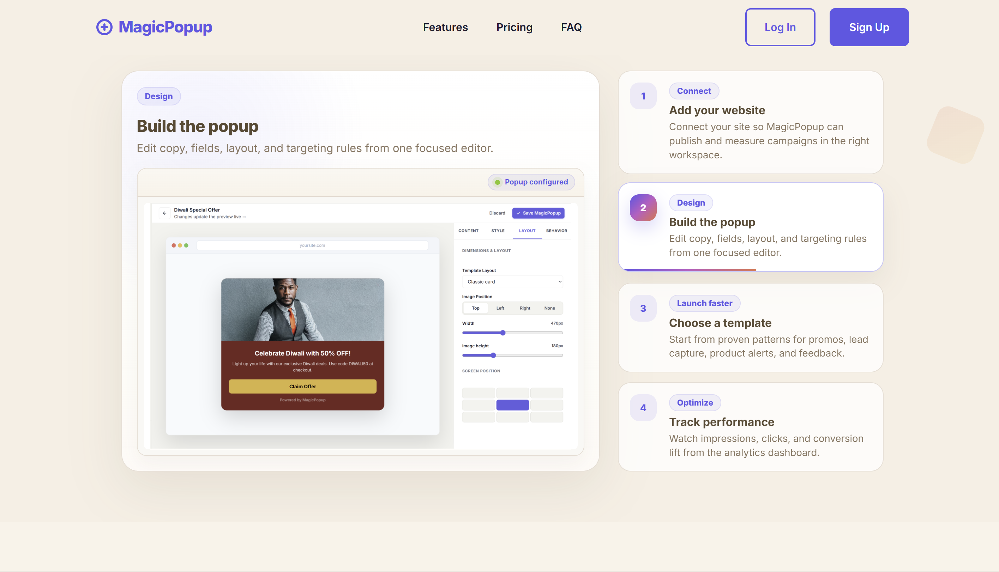

---

### 2. Authentication & accounts

#### Account creation


#### Login
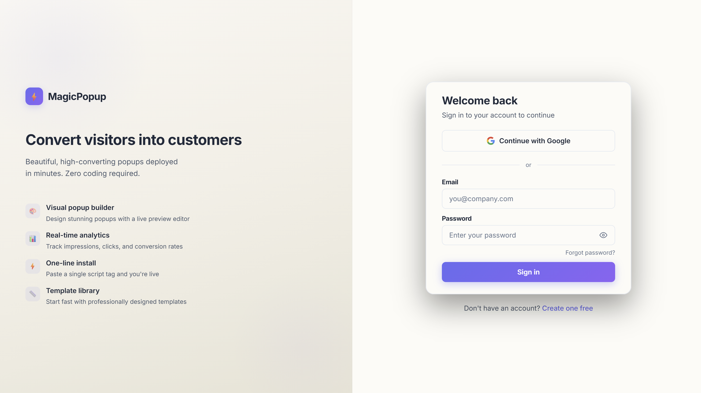

---

### 3. Dashboard & website setup

#### Website dashboard
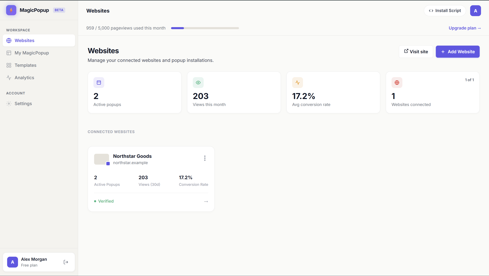

#### Add a website
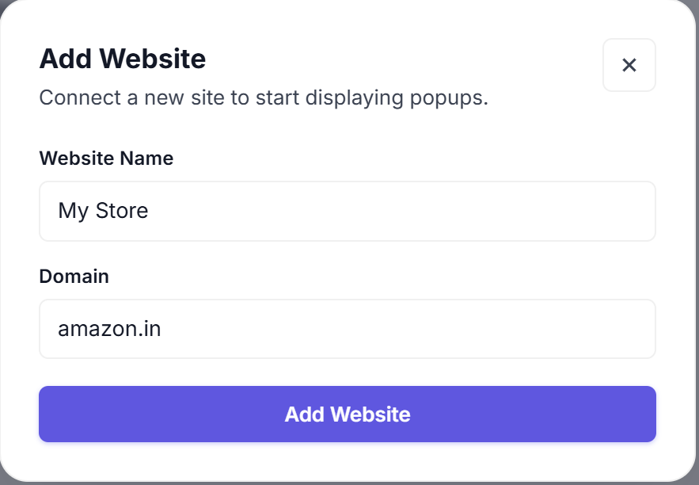

#### Embed script installation
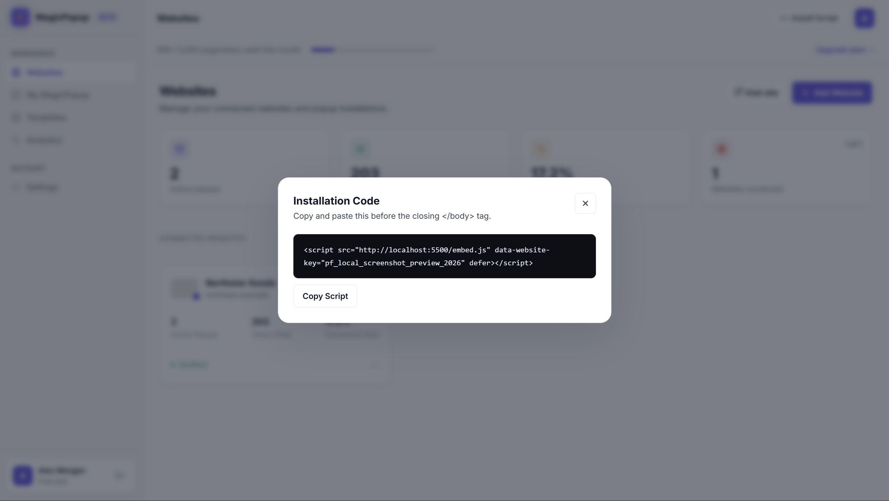

---

### 4. Templates & popup editor

#### Template selection
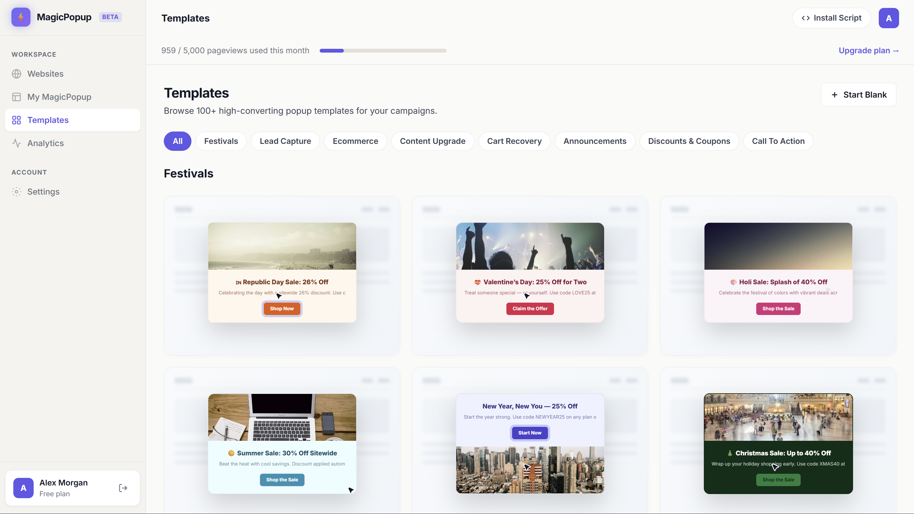

#### Active popups management
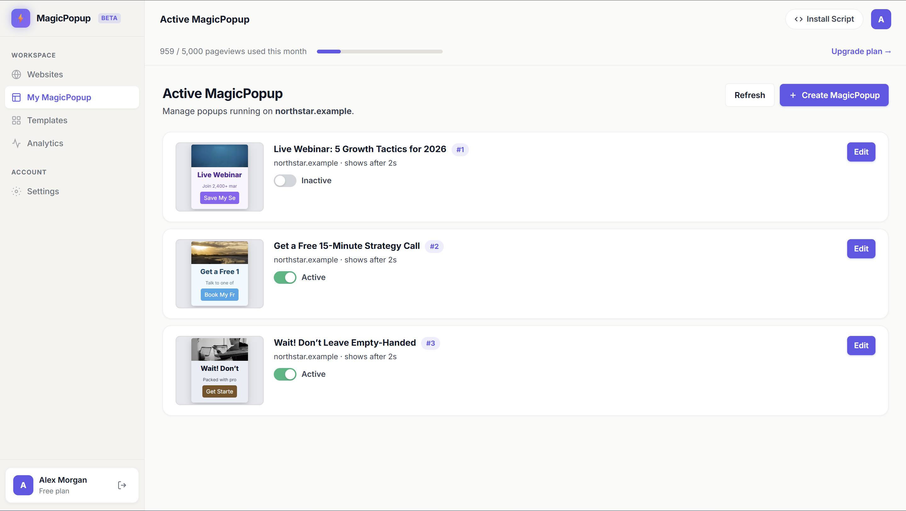

#### Visual editor — Content


#### Visual editor — Design & styling
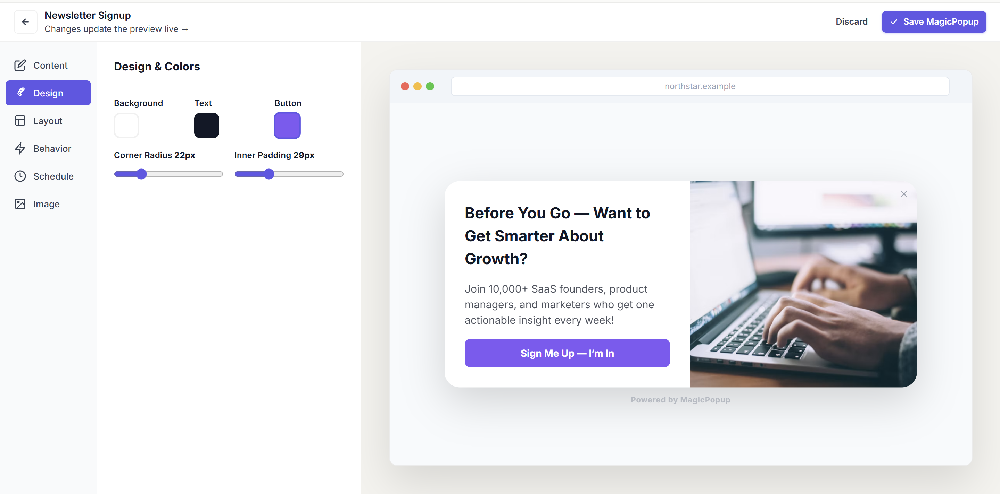

#### Visual editor — Layout & placement
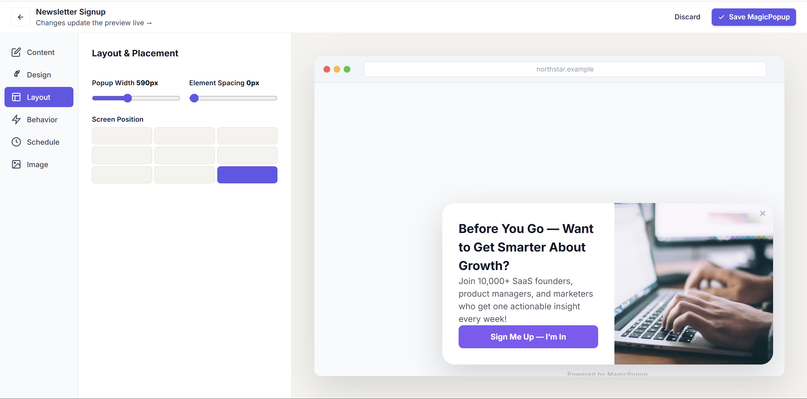

#### Visual editor — Triggers & behaviour
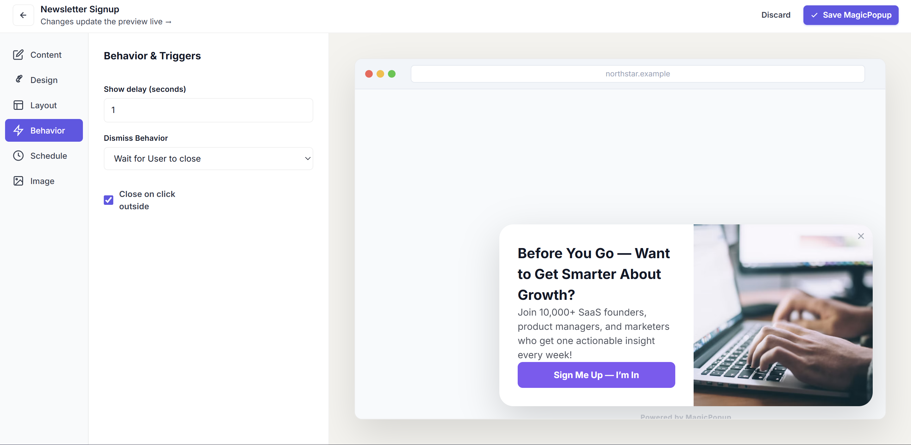

#### Visual editor — Scheduling rules
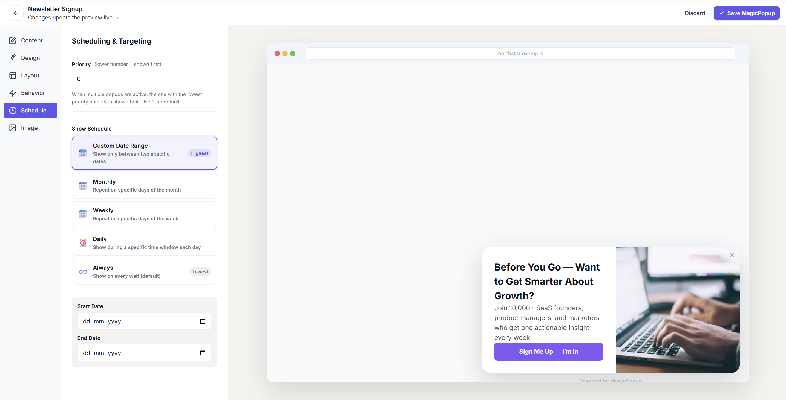

#### Visual editor — Images & assets


#### Early prototype preview
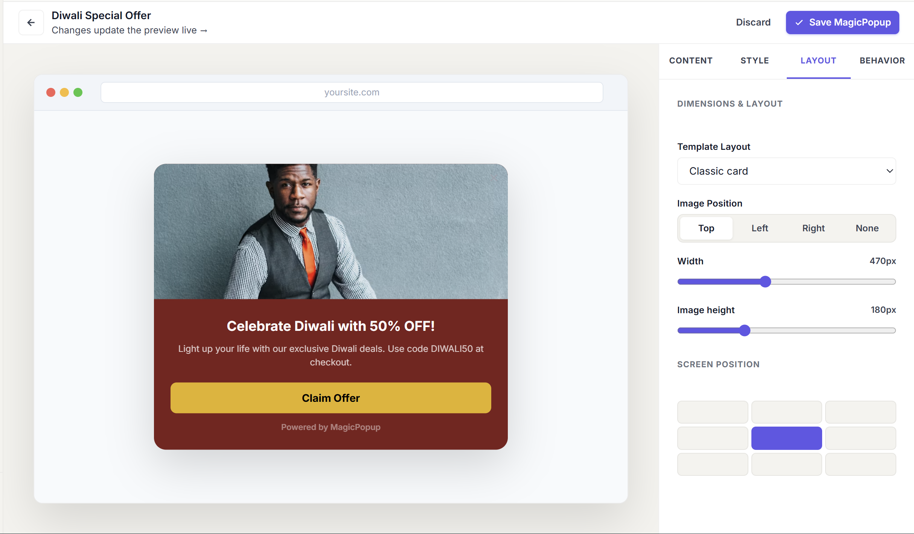

---

### 5. Analytics & reporting

#### Analytics overview
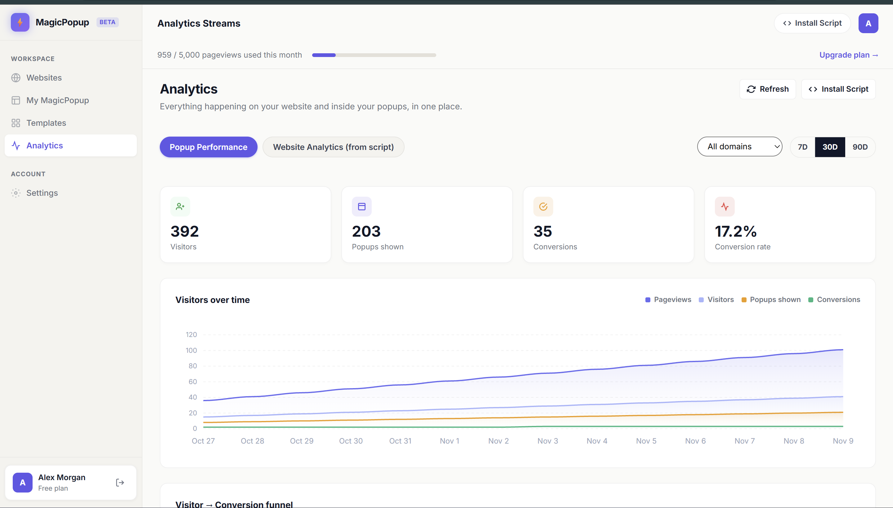

#### Impression & interaction breakdown
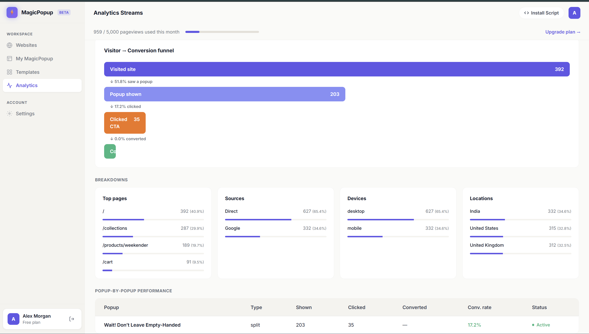

#### Website-level metrics
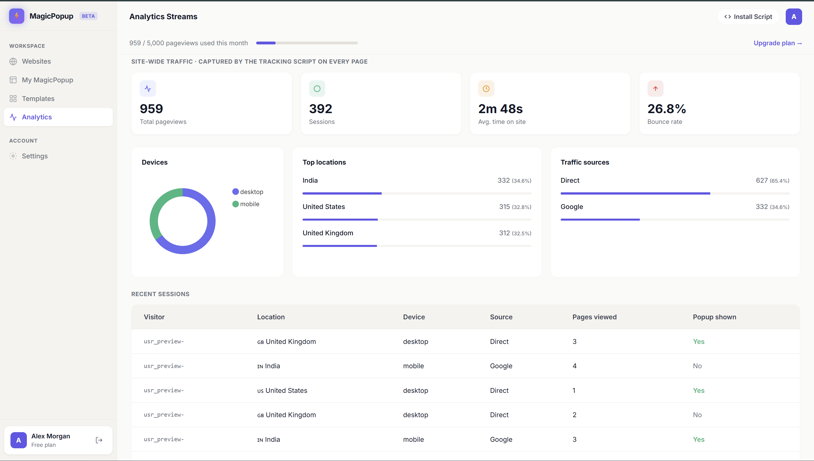

---

## Repository layout

- `src/` — React landing page and its sections.
- `public/` — assets used by the page.
- `docs/screenshots/` — the product gallery shown above.

Built with React and Vite. Original product work by [Malhar Jani](https://malharjani.com).
